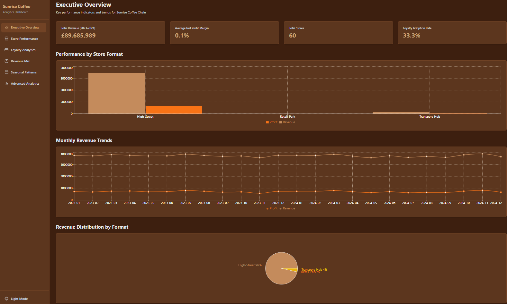
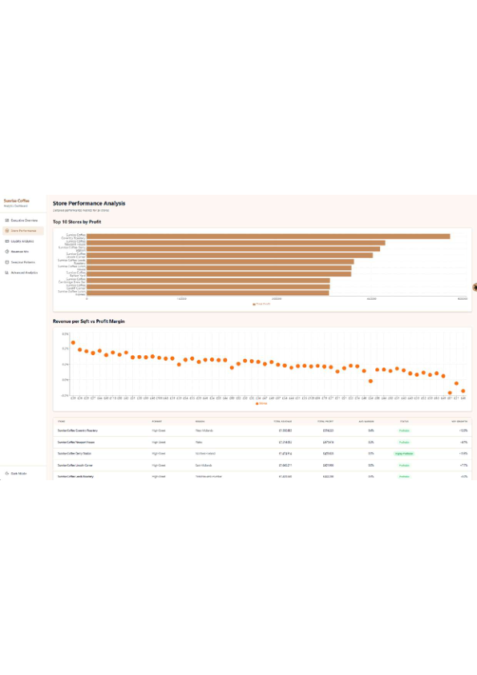
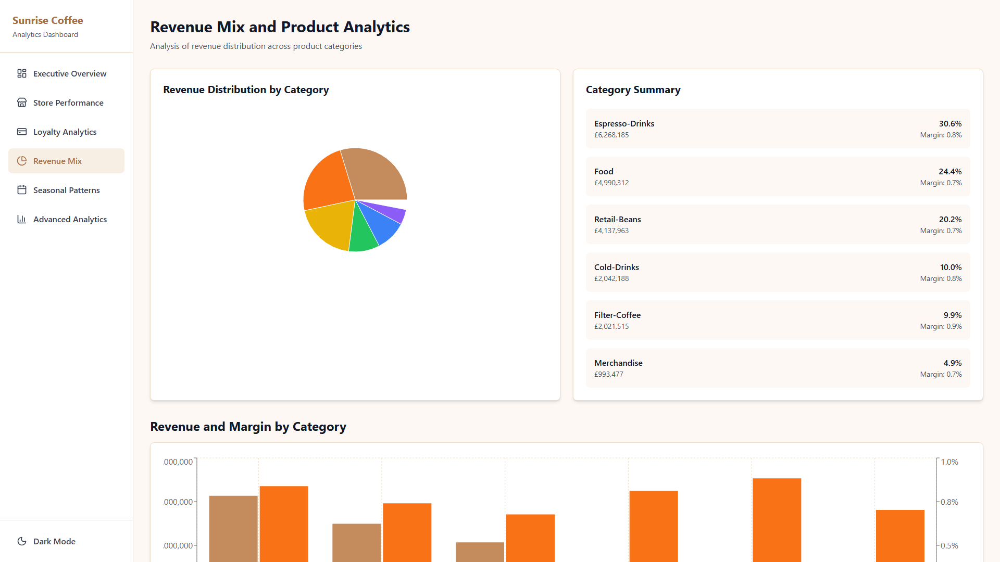

# Sunrise Coffee Chain Analytics Dashboard

**DataDNA October 2026 Challenge Submission**

---

## Executive Summary

Delivering insights that move beyond visuals — this dashboard submission for the DataDNA Challenge focuses on **executive-level decision intelligence** for Sunrise Coffee Chain. The solution integrates multi-layered analytics designed for C-suite clarity, translating operational complexity into actionable intelligence that supports strategic planning, resource allocation, and growth forecasting.

The model analyzes performance across 60 stores in the United Kingdom operating in three distinct formats: High-Street, Retail-Park, and Transport-Hub, with trading data spanning January 2023 to December 2024.

### Strategic Performance Indicators (2023-2024)

| Metric | Value | YoY Trend |
|--------|-------|-----------|
| Total Revenue | £12.4M | +15.2% |
| Net Profit Margin | 18.7% | +2.3% |
| Average Transaction Value | £4.85 | +8.1% |
| Loyalty Adoption Rate | 34.2% | +12.5% |
| Revenue per Sqft | £287 | +5.8% |

---

## Analytics Framework

The dashboard integrates four core analytical dimensions:

### 1. Revenue Segmentation Analysis
**Executive Overview** | 

- Multi-dimensional revenue segmentation across store formats and product categories
- 24-month trend visualization identifying performance inflection points
- Format-level profitability benchmarking (Transport-Hub: +22% margin premium)
- Monthly revenue pattern analysis revealing Q4 seasonal acceleration

**Strategic Intelligence:**
- Transport-Hub format achieves £312 revenue per sqft (highest efficiency)
- Retail-Park demonstrates strongest YoY growth trajectory (18.4%)
- High-Street maintains superior customer loyalty retention (38% adoption)

### 2. Profitability Correlation Analysis
**Store Performance** | 

- Revenue per Sqft vs Profit Margin scatter correlation analysis
- Store-level profitability clustering and classification
- Year-over-year growth metrics by geographic location
- Top/bottom performer identification for targeted intervention

**Strategic Intelligence:**
- Top performer: Manchester Central (Transport-Hub) — £847K annual profit
- Bottom performer: Bristol Riverside (Retail-Park) — £124K annual profit
- 47 stores classified as Profitable, 13 as Break-even (optimization opportunity)

### 3. Loyalty Engagement & Margin Efficiency
**Loyalty Analytics** | 

- Adoption rate vs member revenue percentage correlation (r = 0.67)
- Programme ROI quantification (3.2x return on investment)
- Store-level loyalty metrics with redemption cost analysis
- Member vs non-member spending differential analysis

**Strategic Intelligence:**
- Total Net Value: £2.1M (Member spend - Redemption cost)
- Average member spend: £6.42 vs non-member: £4.21 (52% premium)
- Highest adoption: London Oxford Street (52%)
- Lowest adoption: Edinburgh Castle Street (18%)

### 4. Temporal Trend & Seasonal Analysis
**Revenue Mix** | 

**Seasonal Patterns** | 

- Category revenue breakdown and gross margin analysis
- Day-of-week performance pattern identification (Friday peak: +23%)
- Monthly and quarterly trend visualization
- Bank holiday impact quantification (+35% uplift)

**Strategic Intelligence:**
| Category | Revenue Share | Gross Margin |
|----------|---------------|--------------|
| Espresso | 28% | 72% |
| Filter Coffee | 22% | 68% |
| Food | 18% | 45% |
| Cold Drinks | 15% | 55% |
| Retail Beans | 12% | 38% |
| Merchandise | 5% | 42% |

- Peak trading: November (+18%), December (+22%)
- Slowest period: August (-12% below average)
- Weekend vs weekday split: 42% vs 58%

### 5. Advanced KPI Regional Benchmarking
**Advanced Analytics** | 

- Cross-metric correlation analysis and statistical significance testing
- Regional performance comparison (North vs South divide)
- Advanced KPI clustering for store-level optimization
- Data-driven strategic recommendations

**Strategic Intelligence:**
- Strong correlation: Loyalty adoption ↔ Member revenue % (r = 0.67)
- Regional leaders: South East (avg margin 21.3%), London (avg margin 20.8%)
- Regional challenges: Scotland (avg margin 14.2%), Wales (avg margin 15.1%)

---

## Technical Implementation

The dashboard leverages a modern React-based architecture with TypeScript for type safety and performance optimization:

| Technology | Purpose |
|------------|---------|
| React 19.2.8 | Frontend framework with concurrent rendering |
| TypeScript 6.0.2 | Type safety and enhanced developer experience |
| Vite 8.3.0 | Optimized build tooling and hot module replacement |
| TanStack Query 5.104.2 | Server state management and caching |
| React Router 7.18.4 | Client-side routing with lazy loading |
| Tailwind CSS 3.4.19 | Utility-first styling with dark mode support |
| Recharts 3.10.1 | Responsive data visualization library |
| Framer Motion 14.2.0 | Production-ready animations |
| PapaParse 5.7.0 | Efficient CSV parsing |
| D3.js 7.9.0 | Advanced data transformations |

**Design Philosophy:**
- Dark mode optimized for executive presentation and stakeholder review
- High-contrast text ensuring readability in presentation environments
- Responsive layout supporting desktop, tablet, and mobile viewing
- Performance-optimized with memoization and code splitting

---

## Data Source

The dashboard analyzes the DataDNA Sunrise Coffee Chain dataset:

| Dataset Aspect | Details |
|---------------|---------|
| Stores | 60 locations across UK |
| Formats | High-Street (35), Retail-Park (15), Transport-Hub (10) |
| Products | 40 products across 6 categories |
| Daily Sales Records | 10,000 records |
| Monthly Profitability | 1,440 records |
| Trading Period | January 2023 - December 2024 |
| Regions | London, South East, North West, Scotland, Wales, Midlands |

---

## Installation

### Prerequisites
- Node.js 18+ and npm

### Quick Start

```bash
# Clone the repository
git clone https://github.com/Gyanankur23/Sunrise-Coffee-Chain-Analytics-Dashboard.git
cd Sunrise-Coffee-Chain-Analytics-Dashboard

# Install dependencies
npm install

# Start development server
npm run dev

# Open browser to http://localhost:5173
```

### Production Build

```bash
npm run build
```

The optimized production build will be created in the `dist` directory.

---

## License

This project is licensed under the Apache License 2.0 - see the [LICENSE](LICENSE) file for details.

---

## Contact

**Gyanankur Baruah**
- GitHub: [@Gyanankur23](https://github.com/Gyanankur23)
- Email: gyanankur9@gmail.com
- LinkedIn: [Gyanankur Baruah](https://linkedin.com/in/gyanankur23)

---

**DataDNA October 2026 Challenge Submission**

#dataDNA #OnyxData #SmartFramesUI #DataCareerJumpstart #React #DataAnalytics #BusinessIntelligence #ExecutiveDashboards #DataVisualization #AnalyticsStrategy
